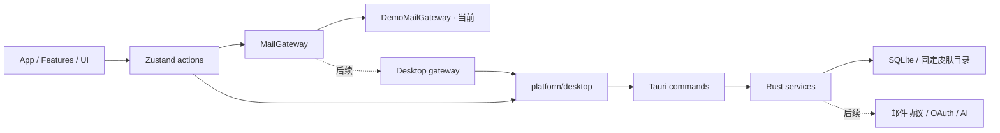

# 基础架构

## 目录与职责

```text
src/
  app/                     应用装配、全局布局、快捷键
  components/layout/       导航等应用布局组件
  components/ui/           无邮件业务的通用 UI 基础
  domain/                  邮件、账号、事件、AI、错误类型
  features/                mail / compose / events / settings / ai
  stores/                  workspace / theme / layout 的状态与动作
  services/demo/           明确标识的演示数据与草稿适配器
  platform/                唯一 Tauri JS 边界
  themes/                  皮肤规范、校验、解析与内置包装配
  styles/                  结构样式及语义变量映射
src-tauri/
  src/                     启动、错误、皮肤目录、数据库迁移器
  migrations/              只追加的 SQL 版本迁移
  capabilities/            主窗口权限
skins/                     随应用编译的纯 JSON 内置皮肤
examples/skins/            可直接复制安装的外部皮肤
schemas/                   从 token 契约生成的编辑器 JSON Schema
tests/                     领域与校验测试
e2e/                       用户行为回归测试
docs/                      开发规范与交接记录
```

## 依赖方向



领域层只定义数据和能力，不依赖 React、Tauri、Zustand。组件不直接发网络请求或操作数据库。当前 `workspaceStore.ts` 是邮件 gateway 唯一装配点；后续加入桌面真实 gateway 时保留组件契约。

`MailGateway` 当前只有读取工作区与保存草稿两项已实现能力。不要为未来协议写返回假成功的占位方法。真实接入时按用例新增分页、同步、发信等接口，禁止把整个 SQLite 邮件库一次装入 Zustand。

## 当前数据流

1. `main.tsx` 在 React 渲染前应用已保存的内置外观，并订阅系统明暗变化。
2. 桌面 Rust 启动时创建应用数据 / 皮肤目录，执行数据库迁移。失败会中止启动；此阶段尚无专用启动恢复窗口。
3. React 装配工作区，从演示 gateway 读取 fixture 与已保存的演示草稿。
4. `workspaceStore` 管理当前账号、文件夹、标签、搜索、选中邮件及本次会话操作。
5. 皮肤独立经桌面命令扫描、前端严格校验，再作为语义 CSS 变量应用。

## IPC 契约

| 命令 | 参数 | 返回值 | 边界 |
| --- | --- | --- | --- |
| `get_app_info` | 无 | version / dataDirectory / skinDirectory / databaseReady | 路径由应用初始化决定 |
| `list_user_skins` | 无 | `{ skins: [{ folderName, manifest, tokens }], warnings: string[] }` | 后台线程，只读固定皮肤目录 |
| `open_skin_directory` | 无 | void | 只打开固定皮肤目录，不接受用户路径或命令 |

Rust 业务失败使用 `{ code, message, retryable }`；前端统一处理 unknown 错误。字段以 camelCase 序列化。桥接类型当前手工维护，变更时必须两端一起修改和验证。

主窗口为本地页面，CSP 禁止外部脚本、远程字体、frame 和任意前端网络连接；没有通用 shell、filesystem、HTTP 插件权限。应用自定义命令由注册 handler 暴露：当前只注册上述三个受限命令。未来添加 WebView 或处理远程 HTML 时必须重新审查权限边界，不得让邮件正文进入可调用 IPC 的页面。

## 存储

桌面路径使用 Tauri `app_data_dir()`；Windows 通常为 `%APPDATA%/com.auu.mailclient/`，以“关于/外观”显示的运行时路径为准。

```text
应用数据目录/
  mail.db                  SQLite v1，当前尚无真实邮箱记录
  mail.db-wal / -shm       SQLite 工作文件
  skins/<skin-id>/         用户安装皮肤
```

v1 表：accounts、folders、messages、message_folders、labels、message_labels、drafts、mail_events、sync_states、outbox；另有 FTS5 表与自动维护触发器。邮件远端 ID 按账号唯一，folder membership 使用复合外键，删除邮件会保留本地事件并解除关联。

`MailMessage.mailbox` 是当前演示 UI 的单分类投影；数据库用关联表支持多文件夹。IMAP UID 必须结合 folder + UIDVALIDITY 保存，不能直接作为全账号远端 ID；真实实现需新增 remote location 映射迁移。Gmail message ID 则按账号隔离。不要用 RFC Message-ID 充当绝对唯一键。

每个新 SQLite 连接均要配置 foreign_keys；初始化使用 WAL。迁移处于单事务，`user_version` 大于本程序支持版本时拒绝打开。v1 发布后不得改写 001，新增 002 等迁移。

当前 FTS5 为基础索引，尚无搜索 IPC；演示搜索是在小型内存数据上做子串匹配。中文分词、排序、分页、附件缓存、磁盘配额、数据库加密、备份恢复均留待真实数据阶段。

## 演示与真实环境

演示账号只使用保留示例域名，不连接服务器。演示草稿与 UI 偏好用版本化 localStorage key；真实草稿必须迁至 SQLite，并增加自动保存、退出保护与恢复。

密码、refresh token、AI Key 不进入这些存储；未来凭据服务统一走系统 keyring。邮件正文与诊断日志分离，日志默认不输出正文、主题、收件人或令牌。
