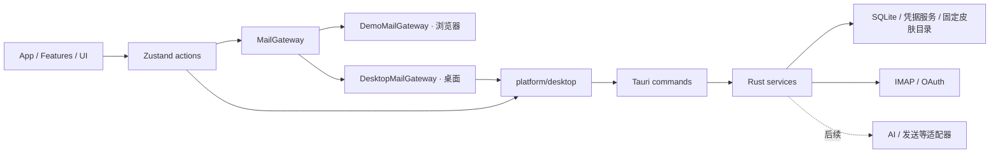

# 基础架构

## 目录与职责

```text
src/
  app/                     应用装配、全局布局、快捷键
  components/layout/       导航等应用布局组件
  components/ui/           无邮件业务的通用 UI 基础
  domain/                  邮件、账号、事件、AI、错误类型
  features/                mail / compose / events / settings / ai
  stores/                  workspace / theme / layout 的状态与动作
  services/demo/           明确标识的演示数据与草稿适配器
  services/desktop/        本机 SQLite gateway（分页 IPC 装配）
  platform/                唯一 Tauri JS 边界
  themes/                  皮肤规范、校验、解析与内置包装配
  styles/                  结构样式及语义变量映射
src-tauri/
  src/                     启动、错误、皮肤目录、数据库迁移器、邮件仓库、凭据、同步与后端调度
  migrations/              只追加的 SQL 版本迁移
  capabilities/            主窗口权限
skins/                     随应用编译的纯 JSON 内置皮肤
examples/skins/            可直接复制安装的外部皮肤
schemas/                   从 token 契约生成的编辑器 JSON Schema
tests/                     领域与校验测试
e2e/                       用户行为回归测试
docs/                      开发规范与交接记录
```

## 依赖方向



领域层只定义数据和能力，不依赖 React、Tauri、Zustand。组件不直接发网络请求或操作数据库。当前 `workspaceStore.ts` 是邮件 gateway 唯一装配点，按 `isDesktop()` 在两个 gateway 间选择；组件契约保持不变。

`MailGateway` 已实现读取、保存草稿、更新邮件状态、仅本机保留修改、恢复 / 原文请求及附件导出。独立 ImapGateway / OAuth store 管理账号设置和授权生命周期。不要为未来协议写返回假成功的占位方法。桌面读取走分页 IPC（`mail_page_messages`，keyset 游标）；当前 gateway 内部循环取完所有页拼快照，UI 增量加载与虚拟列表待后续。禁止把整个 SQLite 邮件库一次装入 Zustand 的长期设计仍然有效。

## 当前数据流

1. `main.tsx` 在 React 渲染前应用已保存的内置外观，并订阅系统明暗变化。
2. 桌面 Rust 启动时创建应用数据 / 皮肤目录，执行数据库迁移（逐版本、单事务）。失败会中止启动；此阶段尚无专用启动恢复窗口。
3. React 装配工作区，按运行环境选择 gateway：浏览器用演示 gateway；桌面用 `DesktopMailGateway`——先把演示数据幂等种子进 SQLite，再从 `mail_load_workspace` 与 `mail_page_messages` 分页读回。
4. `workspaceStore` 管理当前视图并串行提交每封邮件的已读 / 星标 / 归档；本机保存成功后更新投影，reload 保护期间的新修改。真实数据和离线回写意图在 Rust / SQLite；事件完成仍只在会话中。
5. 皮肤独立经桌面命令扫描、前端严格校验，再作为语义 CSS 变量应用。

## IPC 契约

| 命令 | 参数 | 返回值 | 边界 |
| --- | --- | --- | --- |
| `get_app_info` | 无 | version / dataDirectory / skinDirectory / databaseReady | 路径由应用初始化决定 |
| `list_user_skins` | 无 | `{ skins: [{ folderName, manifest, tokens }], warnings: string[] }` | 后台线程，只读固定皮肤目录 |
| `open_skin_directory` | 无 | void | 只打开固定皮肤目录，不接受用户路径或命令 |
| `mail_seed_workspace` | `seed`（演示快照） | void | upsert 演示数据，保留草稿及邮件状态，不删除账号或消息行 |
| `mail_load_workspace` | 无 | `{ accounts, folders, labels, events, syncStates }` | 消息不在此命令，只走分页 |
| `mail_page_messages` | `query { accountId?, mailbox?, labelId?, folderId?, search?, cursor?, limit? }` | `{ items, nextCursor }` | keyset 分页（received_at DESC, id DESC），limit 1–500，FTS 输入做短语转义 |
| `mail_verify_account` | `endpoints { imapHost, imapPort, imapSecurity?, receiveOnly?, smtpHost, smtpPort, authUser }`, `secret` | `{ imap, smtp, folderCount }` | 真实 TLS / 强制 STARTTLS 连接 + 登录测试；IMAP/SMTP 独立出结果；错误不含机密 |
| `mail_save_account` | `account`, `secret` | `id` | 保存前再次验证；密码只写系统凭据库；DB 写失败时恢复旧凭据或删除新增凭据；重配核对 generation |
| `mail_delete_account` | `id` | void | 级联删除账号数据并移除凭据 |
| `mail_sync_account` | `id` | `{ folders, fetchedMessages, syncedAt, warnings }` | 同队列：回写意图、按账号设置增量拉取目录 / 历史、刷新已有标记；密码不经 IPC |
| `mail_update_message` | `accountId, messageId, patch` | MailMessage（含 stateRevision / changes） | 本地状态与字段意图原子提交，不触发网络 |
| `mail_keep_message_local` | `accountId, messageId` | MailMessage | 保留本机覆盖并停止远端回写；applying 时拒绝 |
| `mail_request_recovery` | `accountId, messageId, revision, action` | MailMessage（含 recovery） | 仅登记 check / confirm / retry-archive；联网核对复用账号队列，恢复详情见 REMOTE_RECOVERY |
| `mail_enqueue_sync` | `ids` | `{ revision, jobs }` | 校验后进入后端 FIFO，全局 2 个 worker，同账号去重 |
| `mail_sync_jobs` | 无 | `{ revision, jobs }` | 有界进程内任务快照 |
| `mail_cancel_sync` | `jobId` | `{ revision, jobs }` | 排队取消 / 运行中请求停止；cancelRequested 不等于已释放 worker |
| `mail_list_drafts` | 无 | MailMessage[]（含 draft） | 读取 SQLite 持久草稿 |
| `mail_save_draft` | `draft, previousAccountId` | MailMessage（含新 revision） | 单事务核对版本和原账号；只保存本机，不发送 |
| `mail_import_legacy_drafts` | `drafts` | void | 旧演示草稿一次性导入，完整回滚、收据去重 |
| `credential_status` | `provider, accountId` | bool | 只返回存在性，不返回机密 |
| `credential_save` | `provider, accountId, secret` | void | 写入系统 keyring（Windows Credential Manager） |
| `credential_delete` | `provider, accountId` | void | 幂等，删除不存在的凭据不算失败 |

Rust 业务失败使用 `{ code, message, retryable }`；前端统一处理 unknown 错误。字段以 camelCase 序列化。桥接类型当前手工维护，变更时必须两端一起修改和验证。

主窗口为本地页面，CSP 禁止外部脚本、远程字体、frame 和任意前端网络连接；没有通用 shell、filesystem、HTTP 插件权限。应用自定义命令由注册 handler 暴露。凭据命令只接受已知 provider 标识并做输入长度约束，错误信息不含机密内容。未来添加 WebView 或处理远程 HTML 时必须重新审查权限边界，不得让邮件正文进入可调用 IPC 的页面。

## 存储

桌面路径使用 Tauri `app_data_dir()`；Windows 通常为 `%APPDATA%/com.auu.mailclient/`，以“关于/外观”显示的运行时路径为准。

```text
应用数据目录/
  mail.db                  SQLite v9，账号、邮件、草稿、意图、恢复检查点 / 指纹、持久请求 / 历史 / MODSEQ
  mail-cache/              完整原文哈希缓存 / 临时分块，512 MiB 配额
  mail.db-wal / -shm       SQLite 工作文件
  skins/<skin-id>/         用户安装皮肤
```

v1 表：accounts、folders、messages、message_folders、labels、message_labels、drafts、mail_events、sync_states、outbox；另有 FTS5 表与自动维护触发器。v2 追加 `messages.recipients_json` 与 `accounts.profile_json`（头像 / 颜色 / 状态 / 能力等非机密 UI 元数据）。v3 增加草稿 revision、索引及旧数据导入收据表。邮件远端 ID 按账号唯一，folder membership 使用复合外键，删除邮件会保留本地事件并解除关联。

`MailMessage.mailbox` 是 UI 单分类投影；数据库关联表支持多文件夹，默认按 inbox > sent > drafts > archive > trash 取优先级，本地归档意图优先覆盖投影与查询。v5 保存经 FETCH 确认的 folder / UIDVALIDITY / UID / generation；当前可同步全部可访问目录并暴露 folderIds，额外目录使用原始名摘要作用域；跨目录副本不按 Message-ID 合并。IMAP UID 不能全账号唯一，Gmail message ID 按账号隔离；不以 RFC Message-ID 猜测唯一身份。

每个新连接配置 foreign_keys，初始化使用 WAL。迁移逐版本单事务追加，拒绝打开更高 user_version。已有迁移 001–005 不改写。v4 accounts.sync_generation 保护删除 / 重建 / 重配期间的旧结果；v5 新增 state_revision、已验证定位与 message_changes，每字段意图按 revision 确认。启动恢复 applying 标记为 queued、归档为 unknown，不自动连服务器。

同步已拆成短锁快照、锁外网络 / MIME 解析、短事务提交；每批最多 100 个 UID 范围，原子提交清理、消息与游标。后端 SyncScheduler 固定两个 worker，队列状态与 DB 锁分离。兼容 mail_sync_account 也进入同一队列后等待结果。前端 syncStore 在 App 层观察队列；工作区后台 reload 合并刷新且保留期间新保存的草稿。完整约定与验证范围见 SYNCHRONIZATION。

邮件状态本地提交与 IMAP 网络分离。手动同步先处理最多 200 条意图；标记用单独增减 FLAGS 并读回确认，归档仅 UID MOVE + COPYUID。待回写字段覆盖服务器观察，旧 revision 不能清除新编辑。unknown 移动不自动重试，详情和旧缓存限制见 MESSAGE_CHANGES。

v6 追加原文 content_hash、搜索提示 header_message_id 与 message_recovery。MailGateway.requestRecovery 先保存请求，前端再进入现有同步队列。同步在回写之后、拉取之前读取最多 20 条请求并只读核对；首次展示证据，明确确认后重新核对再提交本地事务，下一次手动同步才回写恢复的意图。保护核对中的原缓存免于 BODY / FLAGS 覆盖和游标清理。证据校验 generation 与整封邮件 state_revision，旧结果不可清除新编辑。副本合并保留原 ID、标签、事件及回复草稿引用；有编辑副本不自动覆盖。详情见 REMOTE_RECOVERY。

v7 追加 recovery_scan。原文指纹是跨 UIDVALIDITY 搜索的前置条件；分页保存完整候选快照、检查游标和匹配摘要，partial 状态只投影为 scanning，不能确认。continue 保留原决定；确认阶段也要重新完整扫描并比较集合摘要。每页网络与 MIME 解析仍在锁外，提交原子核对 generation / state_revision；仅本机、过期和重新开始会清除检查点。不会用旧数值 UID 或 Message-ID 代替内容身份，详见 REMOTE_RECOVERY。

v8 追加 locator_verified / content_hash_verified、恢复 operation 和分段进度。普通完整 FETCH 建立可信定位与原文；弱缓存恢复不自动升级可信来源。fingerprint / confirm-fingerprint 只有可信原定位仍有效时，重复读取原 UID 完整原文并明确确认后补齐可信指纹，保持意图和定位。segmented-v1 依据 UIDNEXT / UIDVALIDITY 固定边界；新检查点按密度选择 1024–50000 UID 的固定区间，旧检查点省略宽度时仍按 50000 读取。逐页核对后逐段重算滚动集合摘要；检查点仅保留当前段 UID 列表和全段摘要，不装载全局大 UID 快照。最终唯一原文与摘要确认后才应用，详见 REMOTE_RECOVERY。

A3.7 的 LimitedStream 位于 TLS 与 IMAP 库缓冲之间，账号验证与同步统一限制单 literal 16 MiB / 单响应 32 MiB、协议行与 SEARCH token。超限永久停止该连接，不采用部分响应；核对保留上个完整检查点，MOVE 结果仍保持 unknown。检查点序列化在 DB 锁外完成，事务继续核对本机版本与账号 generation。限额和兼容规则见 IMAP_LIMITS；没有新增数据库迁移或依赖。

FTS5 已通过 `mail_page_messages` 的 `search` 参数暴露；输入按空白拆词并做短语转义，杜绝 MATCH 语法注入。附件缓存 / 配额已接入；中文分词、排序调优、数据库加密和备份恢复仍待后续。

凭据服务（`src-tauri/src/credentials.rs`）按 `provider:accountId` 作用域写入系统 keyring（当前仅 Windows Credential Manager，跨平台后端随阶段 D 扩展）；机密只能写入与删除，没有任何命令把机密返回给前端。真实账号（阶段 A2）接入时由账号向导调用，不在 localStorage / SQLite 普通字段存储。

## 演示与真实环境

演示账号只使用保留示例域名，不连接服务器。浏览器演示草稿和 UI 偏好用版本化 localStorage key；桌面草稿统一写 SQLite，已加入自动保存、revision 冲突核对、退出保护及最后保存版本恢复。旧 WebView 演示草稿一次性事务导入，保留原数据为备份，详见 DRAFTS。

密码、refresh token、AI Key 不进入这些存储；已建立的凭据服务统一走系统 keyring。邮件正文与诊断日志分离，日志默认不输出正文、主题、收件人或令牌。

## A3.8 模块与 v9 契约

- imap_transport / imap_limits / sync_control：强制 TLS、输入预算、截止时间与停止。
- imap_download / mail_cache / mail_attachments / imap_body：SIZE 规划、精确分块、完整原文缓存、附件另存为和 durable 原文重取。
- imap_settings / imap_jobs / imap_live / imap_condstore：账号选项、持久请求 / 请求版本、两 worker 公平通知、保守 MODSEQ 增量。
- mail_oauth / oauth_flow / account_service：公共配置、PKCE loopback、keyring 刷新、保存补偿与代次。仅公开配置可经 mail_account_config 返回，不返回机密。
- v9 追加 original_remote_id / raw_cache_key / attachments_json / remote_missing、auto_continue、imap_settings / folder_state / history / sync_requests / body_requests / modseq；不重写旧迁移。原连接邮件重配后标缺失，遇相同远端 ID 退休旧存储键并保留旧定位 / 本机 ID，不能直接 UPSERT 套用旧修改。

新增 IPC：mail_imap_settings(accountId)、mail_save_imap_settings(accountId, settings)、mail_request_body(accountId, messageId, revision)、mail_export_attachment(accountId, messageId, index)、mail_account_config(id)、mail_oauth_start(account, config)、mail_oauth_status(flowId)、mail_oauth_cancel(flowId)。返回类型见 domain/imap.ts、domain/oauth.ts 和 platform/desktop.ts；附件返回 bool 区分用户取消，OAuth 阶段不能当作已保存。请求恢复增加 auto-continue，完整确认契约不变。

上述当前行为优先于早期版本说明；配置 / 默认值与锁边界详见 SYNCHRONIZATION、IMAP_LIMITS、OAUTH_SETUP、IMAP_COMPLETION。
