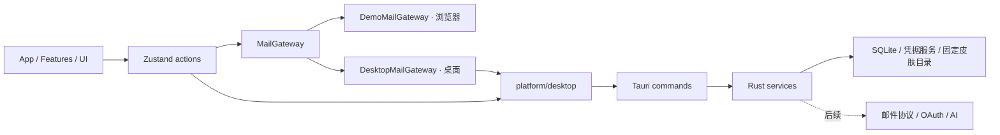

# 基础架构

## 目录与职责

```text
src/
  app/                     应用装配、全局布局、快捷键
  components/layout/       导航等应用布局组件
  components/ui/           无邮件业务的通用 UI 基础
  domain/                  邮件、账号、事件、AI、错误类型
  features/                mail / compose / events / settings / ai
  stores/                  workspace / theme / layout 的状态与动作
  services/demo/           明确标识的演示数据与草稿适配器
  services/desktop/        本机 SQLite gateway（分页 IPC 装配）
  platform/                唯一 Tauri JS 边界
  themes/                  皮肤规范、校验、解析与内置包装配
  styles/                  结构样式及语义变量映射
src-tauri/
  src/                     启动、错误、皮肤目录、数据库迁移器、邮件仓库、凭据服务
  migrations/              只追加的 SQL 版本迁移
  capabilities/            主窗口权限
skins/                     随应用编译的纯 JSON 内置皮肤
examples/skins/            可直接复制安装的外部皮肤
schemas/                   从 token 契约生成的编辑器 JSON Schema
tests/                     领域与校验测试
e2e/                       用户行为回归测试
docs/                      开发规范与交接记录
```

## 依赖方向



领域层只定义数据和能力，不依赖 React、Tauri、Zustand。组件不直接发网络请求或操作数据库。当前 `workspaceStore.ts` 是邮件 gateway 唯一装配点，按 `isDesktop()` 在两个 gateway 间选择；组件契约保持不变。

`MailGateway` 当前只有读取工作区与保存草稿两项已实现能力。不要为未来协议写返回假成功的占位方法。桌面读取已经走分页 IPC（`mail_page_messages`，keyset 游标）；在数据量增大前，桌面 gateway 在内部循环取完所有页拼成快照，UI 侧增量加载与虚拟列表留待真实数据阶段。禁止把整个 SQLite 邮件库一次装入 Zustand 的长期设计仍然有效。

## 当前数据流

1. `main.tsx` 在 React 渲染前应用已保存的内置外观，并订阅系统明暗变化。
2. 桌面 Rust 启动时创建应用数据 / 皮肤目录，执行数据库迁移（逐版本、单事务）。失败会中止启动；此阶段尚无专用启动恢复窗口。
3. React 装配工作区，按运行环境选择 gateway：浏览器用演示 gateway；桌面用 `DesktopMailGateway`——先把演示数据幂等种子进 SQLite，再从 `mail_load_workspace` 与 `mail_page_messages` 分页读回。
4. `workspaceStore` 管理当前账号、文件夹、标签、搜索、选中邮件及本次会话操作（星标 / 已读 / 归档仍仅会话内，随真实同步阶段落库）。
5. 皮肤独立经桌面命令扫描、前端严格校验，再作为语义 CSS 变量应用。

## IPC 契约

| 命令 | 参数 | 返回值 | 边界 |
| --- | --- | --- | --- |
| `get_app_info` | 无 | version / dataDirectory / skinDirectory / databaseReady | 路径由应用初始化决定 |
| `list_user_skins` | 无 | `{ skins: [{ folderName, manifest, tokens }], warnings: string[] }` | 后台线程，只读固定皮肤目录 |
| `open_skin_directory` | 无 | void | 只打开固定皮肤目录，不接受用户路径或命令 |
| `mail_seed_workspace` | `seed`（演示快照） | void | 后台线程；幂等替换种子账号与本地标签，不动其他行 |
| `mail_load_workspace` | 无 | `{ accounts, labels, events }` | 消息不在此命令，只走分页 |
| `mail_page_messages` | `query { accountId?, mailbox?, labelId?, search?, cursor?, limit? }` | `{ items, nextCursor }` | keyset 分页（received_at DESC, id DESC），limit 1–500，FTS 输入做短语转义 |
| `mail_verify_account` | `endpoints { imapHost, imapPort, smtpHost, smtpPort, authUser }`, `secret` | `{ imap, smtp, folderCount }` | 真实 TLS 连接 + 登录测试；IMAP/SMTP 独立出结果；错误不含机密 |
| `mail_save_account` | `account`, `secret` | `id` | 保存前再次验证；密码只写系统凭据库；DB 写失败时补偿删除凭据 |
| `mail_delete_account` | `id` | void | 级联删除账号数据并移除凭据 |
| `credential_status` | `provider, accountId` | bool | 只返回存在性，不返回机密 |
| `credential_save` | `provider, accountId, secret` | void | 写入系统 keyring（Windows Credential Manager） |
| `credential_delete` | `provider, accountId` | void | 幂等，删除不存在的凭据不算失败 |

Rust 业务失败使用 `{ code, message, retryable }`；前端统一处理 unknown 错误。字段以 camelCase 序列化。桥接类型当前手工维护，变更时必须两端一起修改和验证。

主窗口为本地页面，CSP 禁止外部脚本、远程字体、frame 和任意前端网络连接；没有通用 shell、filesystem、HTTP 插件权限。应用自定义命令由注册 handler 暴露。凭据命令只接受已知 provider 标识并做输入长度约束，错误信息不含机密内容。未来添加 WebView 或处理远程 HTML 时必须重新审查权限边界，不得让邮件正文进入可调用 IPC 的页面。

## 存储

桌面路径使用 Tauri `app_data_dir()`；Windows 通常为 `%APPDATA%/com.auu.mailclient/`，以“关于/外观”显示的运行时路径为准。

```text
应用数据目录/
  mail.db                  SQLite v2，当前只有演示种子数据
  mail.db-wal / -shm       SQLite 工作文件
  skins/<skin-id>/         用户安装皮肤
```

v1 表：accounts、folders、messages、message_folders、labels、message_labels、drafts、mail_events、sync_states、outbox；另有 FTS5 表与自动维护触发器。v2 追加 `messages.recipients_json` 与 `accounts.profile_json`（头像 / 颜色 / 状态 / 能力等非机密 UI 元数据）。邮件远端 ID 按账号唯一，folder membership 使用复合外键，删除邮件会保留本地事件并解除关联。

`MailMessage.mailbox` 是当前演示 UI 的单分类投影；数据库用关联表支持多文件夹，查询投影按 inbox > sent > drafts > archive > trash 取优先级。IMAP UID 必须结合 folder + UIDVALIDITY 保存，不能直接作为全账号远端 ID；真实实现需新增 remote location 映射迁移。Gmail message ID 则按账号隔离。不要用 RFC Message-ID 充当绝对唯一键。

每个新 SQLite 连接均要配置 foreign_keys；初始化使用 WAL。迁移逐版本在单事务内追加，`user_version` 大于本程序支持版本时拒绝打开。已发布迁移（001、002）不得改写。

FTS5 已通过 `mail_page_messages` 的 `search` 参数暴露；输入按空白拆词并做短语转义，杜绝 MATCH 语法注入。中文分词、排序调优、附件缓存、磁盘配额、数据库加密、备份恢复留待真实数据阶段。

凭据服务（`src-tauri/src/credentials.rs`）按 `provider:accountId` 作用域写入系统 keyring（当前仅 Windows Credential Manager，跨平台后端随阶段 D 扩展）；机密只能写入与删除，没有任何命令把机密返回给前端。真实账号（阶段 A2）接入时由账号向导调用，不在 localStorage / SQLite 普通字段存储。

## 演示与真实环境

演示账号只使用保留示例域名，不连接服务器。演示草稿与 UI 偏好用版本化 localStorage key；真实草稿必须迁至 SQLite，并增加自动保存、退出保护与恢复。

密码、refresh token、AI Key 不进入这些存储；未来凭据服务统一走系统 keyring。邮件正文与诊断日志分离，日志默认不输出正文、主题、收件人或令牌。
